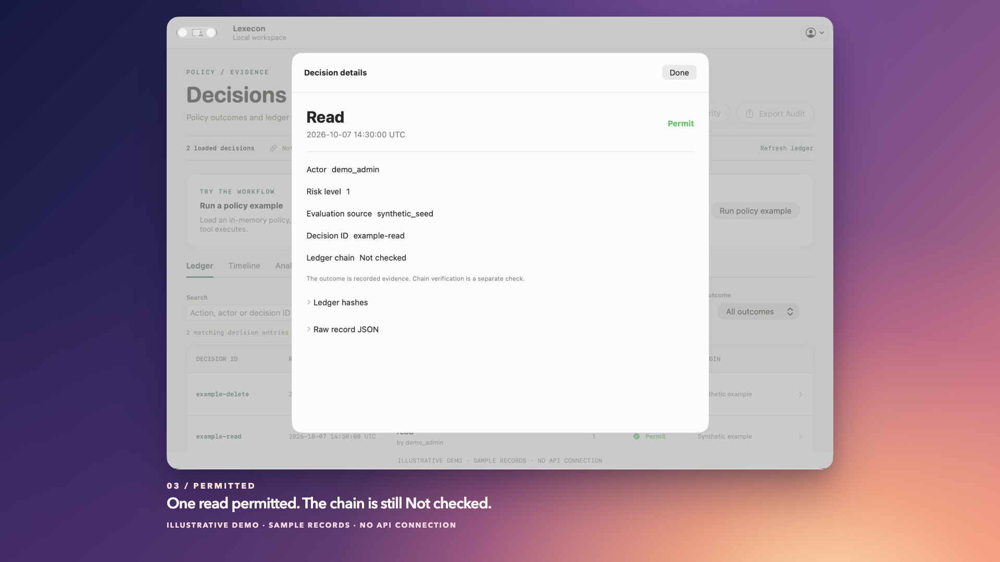
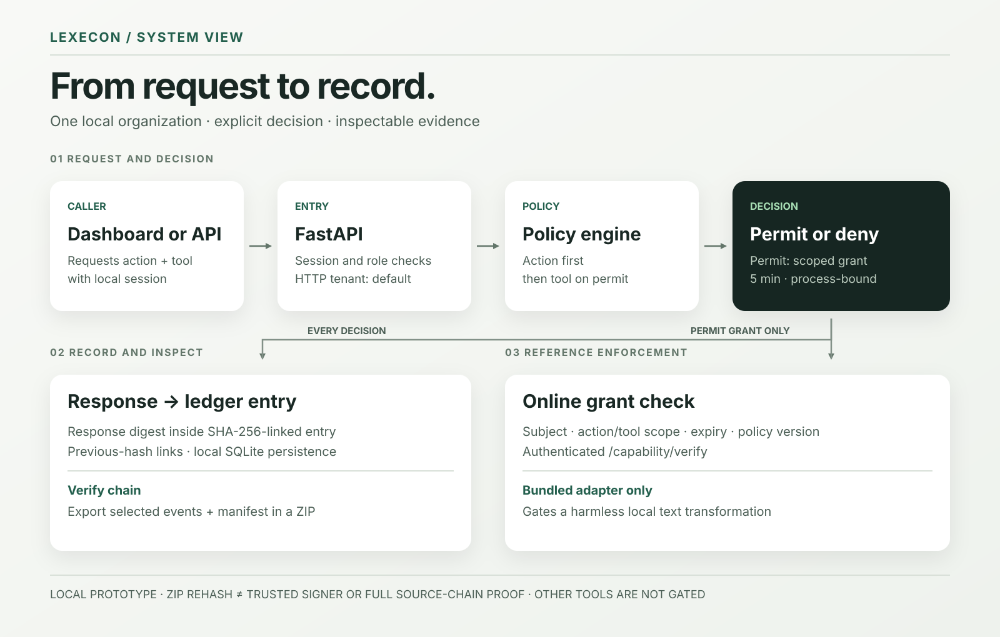

# Lexecon

**A decision you can inspect. A record you can verify.**

Lexecon is a local, single-organization policy and evidence workspace for developers exploring controls around tool-using systems. Its FastAPI service evaluates a requested action and tool against policy, returns a permit or deny, and writes a hash-linked decision event. Native macOS and browser workspaces make the path visible: run a small policy example, inspect both outcomes, verify the ledger, and export an evidence ZIP.

[](docs/showcase/lexecon-macos-walkthrough-35.mp4)

*An edited native Mac walkthrough using unchanged production SwiftUI views. The sample records were placed in an offline test host; the film does not show an authenticated run, a chain check, or a saved ZIP.*

[Watch the 35-second Mac walkthrough](docs/showcase/lexecon-macos-walkthrough-35.mp4) · [Explore the editable Remotion source](docs/showcase/remotion/README.md) · [See the architecture](docs/showcase/architecture.svg)

The short film pairs real native Mac captures with editorial motion and captions. The [previous 54-second edit](docs/showcase/lexecon-macos-walkthrough.mp4) remains available for comparison.

## See it in action

The [native film](docs/showcase/lexecon-macos-walkthrough-35.mp4) tours the Mac workspace and its controls with clearly labeled sample records. The [capture notes](docs/native-walkthrough.md) identify the offline states and in-process UI actions. Runtime checks are recorded separately in [release validation](docs/release-validation-2026-10-07.md).

In an authenticated local run, the dashboard's guided example loads an in-memory policy that permits a read with `safe_demo` and denies a delete. It calls the real policy and decision endpoints, then compares both responses with their ledger entries. It **does not execute a tool**. The separate command-line proof shows the reference adapter checking a grant online before one harmless text transformation.

| Decide | Verify | Inspect and export |
| --- | --- | --- |
| A permit and a deny from the loaded policy | Response-to-ledger comparison and full-chain integrity check | Decision detail and a downloadable evidence ZIP |

The [archived browser demo](docs/showcase/stipple-demo.mp4) uses screenshots from a real local run under the earlier Stipple name. It is distinct from the new illustrative native Mac film. [The browser walkthrough](docs/showcase/walkthrough.md) explains the API flow and what each check establishes.

## Open the native Mac app

The app targets macOS 14+. Building it requires Apple developer tools with **Swift 6.2+ and the macOS 26+ SDK**, plus Python 3.9+ and [`uv`](https://docs.astral.sh/uv/). Check the selected tools with `scripts/build-macos.sh --check`. From the repository root:

```sh
python3 scripts/start-macos.py
```

The launcher builds `macos/dist/Lexecon.app`, installs locked Python dependencies if needed, prompts for a local `admin` password on first run, and starts the FastAPI service on `127.0.0.1:8000`. It opens Lexecon.app; keep the terminal open while using it. Existing `.lexecon/` data is reused. Press Ctrl+C to stop the API. The app keeps its session only in memory.

Sign in to the **Decisions** dashboard and select **Run policy example**. Search or filter the ledger, choose a row for its evidence, select **Verify Integrity**, and **Export Audit**. Export saves a ZIP using the macOS file dialog. The in-memory example policy requires admin access and asks before replacing an existing policy. No tool executes during this UI example. [Mac implementation and design notes](macos/README.md) describe the scope and build path.

## Open the local dashboard

Requires Python 3.9+, [`uv`](https://docs.astral.sh/uv/), Node.js, and npm. From the repository root:

```sh
python3 scripts/start-local.py
```

On first run, the launcher installs locked dependencies as needed and prompts for a strong password for the local `admin` account. It stores data in the ignored `.lexecon/` directory, starts the API and dashboard on `127.0.0.1`, and opens <http://127.0.0.1:3000/login>. Keep the terminal open; Ctrl+C stops both servers. The launcher reuses existing data and does not reset an administrator.

1. Sign in with the password you chose.
2. Select **Run policy example**. If a policy is already loaded, confirm that the example may replace it in memory.
3. Read the permitted `read` and denied `delete` results. Select **Verify Integrity**, open a decision, then **Export Audit**.

The example records `evaluation_source: policy_engine` on real decision events. The caller-supplied `demo_requested` flag is only a display hint. Older `/demo/seed` events carry `evaluation_source: synthetic_seed`; they are not policy evaluations. See the [walkthrough](docs/showcase/walkthrough.md) for the distinction.

## Prove the enforcement boundary

The disposable command-line proof needs no browser, Redis, cloud service, live model, or external account:

```sh
uv sync --locked --extra dev
.venv/bin/python scripts/demo-proof.py
.venv/bin/python -m pytest -q -o addopts='' tests/test_security_regressions.py
```

It creates a temporary local admin, loads the example policy, calls `/decide` and `/decide/verify`, and exercises the [reference adapter](scripts/reference_tool_adapter.py). That adapter checks a process-bound grant through authenticated `/capability/verify` before uppercasing `local demo`. It rejects a forged grant; an unapproved tool receives HTTP 403. Expected proof output includes `"verified_tool_result": "LOCAL DEMO"` and `"forged_grant_blocked": true`. The temporary data is removed on exit.

## Connect a local Hermes agent

The optional [Hermes integration](integrations/hermes/README.md) provides two bounded workspace tools that check Lexecon inside their handlers before reading or listing files. It includes a conservative starter policy, isolated-profile preparation and owner-operated authentication. Automated tests exercise real Hermes dispatch and Lexecon API logic; live account activation is a separate step. This does not sandbox all Hermes tools or automatically connect the Mac app to an agent. The isolated mandatory-dispatch candidate and its verification are documented in [the required-gate report](docs/hermes-required-gate-validation-2026-10-09.md).

## How it fits together

The [architecture notes](docs/showcase/architecture.md) explain the decision, enforcement, and evidence boundaries.



- **Decision:** authenticated requests reach the policy engine through FastAPI. A permit needs both the action and requested tool allowed by policy. The decision service issues a short-lived, process-bound capability grant on a permit.
- **Enforcement:** `/capability/verify` checks subject, scope, expiry, and current policy version. The bundled adapter gates one harmless local transform. Other tools are not automatically gated by Lexecon.
- **Evidence:** `/decide` binds the response to a ledger entry through a response digest. The ledger uses SHA-256 links and SQLite persistence in local mode. The dashboard can inspect decisions and request a chain integrity check.
- **Export:** the evidence ZIP includes a selected event set and file manifest. [The saved-ZIP verifier](scripts/verify-evidence-zip.py) rehashes those files and events. That check does not establish trusted signer identity or the complete source chain without the original ledger.

The supported HTTP tenant is `default`, representing one shared organization. The diagram describes the supported local path; it does not imply a deployed distributed authorization system.

## Verify the candidate

The [GitHub handoff](docs/github-handoff.md) explains fixed-commit source packaging and the manual validation workflow. [Contributor commands](CONTRIBUTING.md) and [account-free validation results](docs/github-validation-2026-10-08.md) provide repeatable checks without creating a local account.

The [candidate verification record](docs/portfolio-verification.md) lists commands, results, and limits; the [earlier release checks](docs/release-validation-2026-10-07.md) record the October 7 baseline. The [local release checklist](docs/local-release-checklist.md) covers subsequent session/setup fixes and the normal-use walkthrough the owner can perform without sharing a password. The [security scan triage](docs/security-scan-triage.md) distinguishes an older source scan from this copy. Repository-wide Ruff and mypy retain legacy failures; those checks are not claimed as passing gates.

Before preparing a release, run `python3 scripts/check-key-history.py .`. It checks locally reachable history, staged files, and eligible working files for PEM private keys without displaying their contents. The [signing-key investigation](docs/signing-key-history.md) records the original repository's exposed key history, this candidate's independent clean history, scanner limits, and the remaining decision about historical external trust. Merging this candidate into the old repository does not remove exposed ancestors.

This is a portfolio prototype for local review. It is not a production authorization service or compliance certification. Global governance stores lack verified tenant predicates; HTTP MFA enrollment and challenge completion are incomplete; requested escalation recipients are not an identity directory; and there is no deployed tool adapter beyond the local reference example. Historical signing-key use remains unresolved in the original repository. This source snapshot does not change that history or deploy the application. See the [current snapshot validation and provenance](docs/current-snapshot.md).

## Repository guide

| Path | What it contains |
| --- | --- |
| [`src/lexecon/api/`](src/lexecon/api/) | FastAPI routes and local session dependencies |
| [`src/lexecon/policy/`](src/lexecon/policy/) | Deterministic policy matching |
| [`src/lexecon/decision/`](src/lexecon/decision/) | Decision orchestration and capability grants |
| [`src/lexecon/ledger/`](src/lexecon/ledger/) | Hash-linked event chain |
| [`src/lexecon/evidence_export/`](src/lexecon/evidence_export/) | ZIP evidence bundle generation |
| [`macos/`](macos/) | Native macOS workspace |
| [`frontend/`](frontend/) | React browser dashboard |
| [`scripts/`](scripts/) | Local launcher, disposable proof, reference adapter, ZIP check |
| [`docs/showcase/`](docs/showcase/) | Architecture, guided walkthrough, screenshots, and demo source |

MIT licensed. See [SECURITY.md](SECURITY.md) for this candidate's security boundary.
