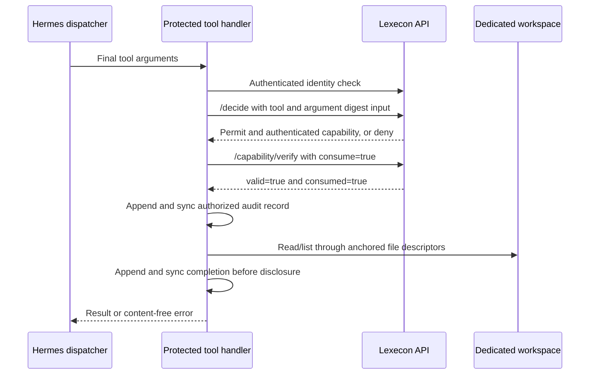

# Lexecon for Hermes

This optional plugin connects Hermes tool dispatch to Lexecon. The Mac app is the policy/evidence workspace; it does not automatically attach to an agent. The plugin offers **two protected tools**: `lexecon_list_files` and `lexecon_read_file`. Each handler authenticates the dedicated user, requests a decision for the final arguments, consumes the argument-bound grant, then accesses one configured workspace. A local audit correlates requests, authorization and completion with Lexecon decision IDs.

It is a bounded local integration, not a general Hermes sandbox or a production deployment. No live agent credentials or profiles are included. The required host patch is based on Hermes 0.21.5, source `84f87a18c0ad9f1a6d646df839110103f3204346`; revalidate when Hermes changes. An unpatched Hermes installation does not contain this host guard.

## Scope and flow



The starter policy permits only the dedicated actor's `list`/`read` actions and these two tool names. Strict mode denies other actions. The plugin enforces the workspace boundary; the policy alone does not restrict filesystem paths. Tools accept one relative `path`. Reads support UTF-8 `.txt`, `.md`, `.csv`, `.rst` up to 32 KiB. Traversal, hidden/sensitive names, symlinks, hardlinks, devices, binary content and large files are refused. A list examines at most 512 directory entries. Put only approved sample content in this workspace; filename filtering cannot identify every secret.

The generated profile exposes only `lexecon_workspace`, disables dynamic tool search, and requires the two registered Lexecon handlers. The required launcher arms the isolated host before plugin discovery and then pins the loaded plugin and actual handlers. Mandatory checks cover the registry, ordinary model dispatch, direct and managed agent invocation, catalog and connector paths. They reject other tool names, missing or substituted handlers, changed requirements and foreign scopes independently of optional hooks. The original outer hook alone can fail open; ordinary installed Hermes is not equivalent to this candidate. Protected handlers still own final-argument authorization and consumption. Arbitrary trusted Python can bypass dispatch; there is no OS sandbox or universal interception claim.

## Required host patch

Use a separate clean Hermes checkout for the required host guard. [The patch](required-tool-gate.patch) and [base/commit manifest](required-tool-gate.json) reproduce its changes against upstream `84f87a18c0ad9f1a6d646df839110103f3204346`. Check the exact base and run `git apply --check /absolute/path/to/required-tool-gate.patch` before applying it. Do not apply it to an active Hermes installation.

## Prepare without changing your existing setup

From the Lexecon checkout, choose a new physical directory outside `~/.hermes`. On macOS `/tmp` and `/var` may be symlinks; prefer the checkout's absolute path. Preparation refuses an existing destination and creates no account or session:

```sh
LEXECON_HERMES_HOME="$PWD/.lexecon/hermes-required-pilot"
python3 integrations/hermes/owner_setup.py prepare --home "$LEXECON_HERMES_HOME"
python3 integrations/hermes/owner_setup.py status --home "$LEXECON_HERMES_HOME"
```

This creates a separate Hermes home with the plugin, minimal configuration, a harmless `workspace/welcome.txt`, and the reviewable `starter-policy.json`. The private directory is mode 0700; a future session is stored at mode 0600 outside the readable workspace. No default Hermes configuration, Jev adapter, model-provider credentials or existing projects are copied.

## Owner-operated activation

These steps deliberately require your participation. Policy setup temporarily changes the active policy for all API callers; approve that action only when other callers can tolerate the change. Start the updated Lexecon API using `python3 scripts/start-macos.py`; stop an older launcher first so the new capability API is loaded. Keep the service bound to `127.0.0.1:8000`. An API restart clears its in-memory policy.

1. Review the generated policy and dedicated workspace.
2. Run `provision` below. Enter the existing admin password privately, then explicitly confirm creation of the dedicated viewer and choose its password twice. An existing viewer is reused without resetting its password. Admin logout is attempted on exit; an outage can prevent confirmed revocation.
3. Run `load-policy`. By default it refuses a nonempty or non-strict policy. The `--allow-policy-replacement` override is available when replacing an existing policy is intended. It exports and hash-checks the prior policy, writes an immutable private recovery snapshot, then conditionally loads the strict starter policy. Save the printed snapshot path. A concurrent version change is refused. A lost response triggers read-back, never an automatic second mutation; retain the snapshot if the result remains unknown.
4. Run `login`. Enter the dedicated viewer password, not the admin password. No token is printed. Password-expiry or login failure stops setup.

```sh
python3 integrations/hermes/owner_setup.py provision --home "$LEXECON_HERMES_HOME"
python3 integrations/hermes/owner_setup.py load-policy --home "$LEXECON_HERMES_HOME"
python3 integrations/hermes/owner_setup.py login --home "$LEXECON_HERMES_HOME"
```

After those owner-operated steps, verify the running API and actual Hermes dispatcher without a paid model call:

```sh
HERMES_CHECKOUT="/absolute/path/to/clean-hermes-checkout"
HERMES_PYTHON="/absolute/path/to/existing/hermes/venv/bin/python"
"$HERMES_PYTHON" integrations/hermes/verify_live.py \
  --home "$LEXECON_HERMES_HOME" --hermes-checkout "$HERMES_CHECKOUT"
```

The proof uses the existing session, lists and reads the unchanged welcome fixture, rejects traversal, requests a denied delete action without executing a delete, and correlates local audit records. It prints decision IDs and status, not tokens or file contents. It makes real local API requests and writes decision/audit events. It does not create an account or load policy.

Launching Hermes with this isolated home is a separate owner action:

```sh
"$HERMES_PYTHON" integrations/hermes/launch_required.py \
  --home "$LEXECON_HERMES_HOME" --hermes-checkout "$HERMES_CHECKOUT"
```

The launcher refuses an unpatched checkout, an old profile missing the required configuration, or an unexpected toolset. Use a newly prepared isolated profile; existing prepared homes are never silently upgraded. This home intentionally has no copied provider credentials. Configure a provider yourself if needed; model calls may incur costs. Ask Hermes to list the workspace, then read `welcome.txt`. A successful read includes a Lexecon `decision_id`; correlate it with the Mac app's decision ledger and `private/audit.jsonl`. Asking to read `../outside.txt`, execute shell commands, or write a file must not execute those actions. Do not use the Mac UI's policy example while this integration is active: it replaces the policy and invalidates grants.

## Repeatable verification

No live account, provider call or socket is needed for the automated regression suite:

```sh
.venv/bin/python -m pytest -q -o addopts='' \
  tests/test_bound_capabilities.py \
  integrations/hermes/tests/test_plugin.py \
  integrations/hermes/tests/test_owner_setup.py \
  integrations/hermes/tests/test_verify_live.py
```

Real Hermes loader/dispatcher tests use Hermes's canonical runner. Supply your checkout and its existing test interpreter; this does not install dependencies or activate a different environment:

```sh
LEXECON_CHECKOUT="$PWD"
HERMES_CHECKOUT="/absolute/path/to/clean-hermes-checkout"
HERMES_PYTHON="/absolute/path/to/existing/hermes/venv/bin/python" \
  "$HERMES_CHECKOUT/scripts/run_tests.sh" \
  "$HERMES_CHECKOUT/tests/tools/test_required_tool_gate.py" \
  "$LEXECON_CHECKOUT/integrations/hermes/tests/test_required_runtime.py" \
  "$LEXECON_CHECKOUT/integrations/hermes/tests/test_api_integration.py" \
  -- -o addopts= -q
```

`test_api_integration.py` connects real Hermes dispatch, actual Lexecon decision/capability routes and policy engine, the hash-linked ledger and real temporary file reads. It proves permit, policy denial, expired test principal, changed policy, altered arguments and reused grants. Its authentication dependency and in-process transport are test fixtures. It **does not prove live login, a running loopback server, provider execution or the user's active installation**. Those checks remain pending owner activation. Other tests cover final arguments rewritten by hooks, direct/parallel dispatch, rejected bridge/catalog paths, skipped/broken hooks, audit failure, filesystem restrictions and concurrent grant consumption. The older `test_hermes_dispatch.py` characterizes the original unpatched host; its fail-open sentinel assertion is intentionally not a required-host acceptance test.

## Capability API contract

`POST /decide` accepts optional `tool_arguments` (a JSON object). Its SHA-256 digest uses Python `json.dumps(..., sort_keys=True, separators=(",", ":"), allow_nan=False)` with default ASCII escaping; this is not RFC 8785 number canonicalization. JSON values only, string keys, depth at most 32 and serialized size at most 64 KiB are accepted. A bound grant carries the authenticated `arguments_digest`.

`POST /capability/verify` takes the grant, action, tool, identical `tool_arguments` and strict boolean `consume`. It returns `{valid, consumed}`. The plugin requires both fields to be `true`; missing fields and old unbound grants stop execution. The API retains legacy non-consuming verification when no arguments were bound; generic adapters must opt into binding and consumption. After successful consumption every later verification of that grant fails, including a non-consuming check. No raw tool arguments or file contents are stored in the decision ledger.

## Errors and rollback

No characters appear while Terminal accepts passwords; this is normal. A completed admin setup does not itself connect Hermes. `status` checks local structure only. The handler returns stable errors without credentials or file contents: `authentication_required` requires owner login; `policy_denied` requires reviewing policy; `verification_denied` may follow policy change/expiry/replay; `audit_unavailable` requires fixing private directory/file ownership or disk availability. Do not bypass these checks.

Stop the isolated Hermes process to stop this integration. Run:

```sh
python3 integrations/hermes/owner_setup.py logout --home "$LEXECON_HERMES_HOME"
```

Logout revokes the dedicated session before removing its local token. If the API is unavailable, revocation is not confirmed and the helper leaves the token intact for retry. Keep the isolated home and audit if needed; no deletion is required. Your ordinary Hermes home remains unchanged. The dedicated viewer account persists after logout. Account removal is a separate administrator action. To restore the prior policy, use the exact private snapshot path printed by `load-policy`:

```sh
python3 integrations/hermes/owner_setup.py rollback-policy \
  --home "$LEXECON_HERMES_HOME" --snapshot /absolute/path/to/private/policy-SNAPSHOT.json
```

This requires private admin login and explicit confirmation. Restore proceeds only if the current policy still matches the recorded starter target, and the API checks that version atomically. Another policy change is refused. Keep the snapshot and receipts. If both the rollback response and follow-up observation are unavailable, the outcome is unknown; a later retry refuses a differing current hash rather than claiming success or blindly writing again.

Restarting Lexecon invalidates process-bound grants and starts with an empty strict policy.

## Remaining trust boundaries

- Required startup trusts plugin code during discovery. Handler pinning is not protection against a malicious Python plugin before sealing. Editing `plugins.enabled` alone is not immediate revocation; stop/restart or rediscover the process. Requirements are pinned per profile until restart.

- The HTTP destination is fixed to loopback (port 8000 by default, or explicitly configured isolated audit port 8765) with no proxies or redirects. There is no server identity pinning or TLS: another local process able to replace the listener can impersonate Lexecon and obtain the session. Only use a trusted local machine and service. Timeouts are socket inactivity limits, not a whole-request deadline.
- The session must remain a non-admin identity matching the configured actor. Every protected invocation checks identity and uses the same token for its API requests. Sessions expire; tools stop until the owner logs in again.
- Capability digests bind canonical final arguments and workspace device/inode. A grant is single-use within the issuing process, expires after five minutes, and is rejected when the current policy hash differs or the service restarts. Reverting to an identical policy hash can make an unconsumed, unexpired grant valid again; policy changes are not irreversible revocation. Consumption authorizes an attempt, not successful execution. There is no distributed consumption store; do not run multiple workers as a shared authority.
- Policy verification is point-in-time, not a transaction spanning the filesystem read. Arguments bind the requested location, not an immutable content snapshot. Normal file updates between verification and reading are possible; a detected change during reading is refused.
- The local audit is append-and-sync evidence, not tamper-proof storage. Authorized local users can alter it. Lexecon's hash linkage detects changes only relative to a trusted chain head; neither log proves a tool ran successfully outside this handler.
- This integration does not establish hosted or production readiness. See the repository's [security scope](../../SECURITY.md).
